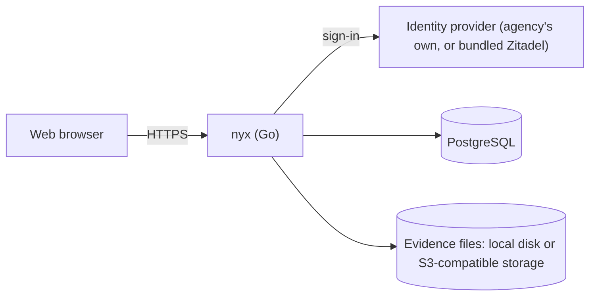

# NyxOps

NyxOps is a free, open source records management system (RMS) for law enforcement agencies. It's built for small and mid-sized departments that need modern, secure records software they can run on their own infrastructure, without the cost of commercial RMS contracts.

> Status: early development. NyxOps isn't ready for production use.

## What NyxOps does

- Incident reporting with narratives, attachments, and an investigation workflow
- Person and vehicle records, with a master person index that detects likely duplicates for human review
- Arrest and booking records, charges, and mugshots
- Evidence tracking with a verifiable chain of custody
- Warrant tracking with expiration alerts
- NIBRS reporting, with validation errors shown while the officer writes the report instead of at month-end
- Records retention, legal holds, and court-ordered sealing and expungement
- Report drafting that keeps working when the patrol car loses its connection
- Multi-agency deployments with strict separation between agencies

## Accountability built in

NyxOps records every access to and change of a record in an audit log built on the same Merkle tree design as Certificate Transparency. Each agency can have an outside party, such as a state auditor or a court clerk, cosign the log at regular intervals. After that, nobody, including a database administrator, can edit or delete an audit entry without breaking the cryptographic proof.

Expungement reaches backups too. Every sealed record group has its own encryption key, and destroying that key makes the record unreadable in the live database and in every backup taken before the order.

## Architecture

NyxOps ships as a single Go program that serves the API, the web interface, and background jobs. PostgreSQL holds all application data, the job queue, search indexes, and the audit log, so a small agency runs four containers or fewer.

Agencies that already use Microsoft Entra ID, Okta, or another OpenID Connect provider sign in with their existing accounts. Larger and multi-agency deployments run on Kubernetes.

## Technology

| Layer | Technology |
| --- | --- |
| Backend and workers | Go |
| Database | PostgreSQL 18 |
| Background jobs | River (PostgreSQL-backed) |
| Frontend | React, TanStack Router and Query, shadcn/ui, Tailwind CSS |
| Sign-in | OpenID Connect; Zitadel bundled for agencies without an identity provider |
| File storage | Local disk or any S3-compatible service |
| Search | PostgreSQL full-text and fuzzy name search |
| Rules and policies | CEL (Common Expression Language) |
| Report documents | Typst |
| Deployment | Docker Compose, Kubernetes (Helm) |

NyxOps keeps its dependency list short on purpose: the production server depends on six outside Go modules. Security-sensitive logic that defines an RMS, such as access control, auditing, NIBRS validation, and retention, lives in the NyxOps codebase where anyone can review it.

## Security

NyxOps targets the FBI CJIS Security Policy from the first line of code.

- PostgreSQL row-level security enforces separation between agencies and access to sealed and juvenile records, in addition to checks in the application.
- Access to sensitive records requires a stated reason, which goes into the audit log.
- The audit log is append-only and verifiable by outside witnesses the agency chooses.
- Sensitive fields and evidence files are encrypted with per-record keys.
- The browser never holds sign-in tokens; sessions use secure, HttpOnly cookies.
- Cryptography comes from Go's FIPS 140-3 module.
- Every release includes a software bill of materials, a signed container image, and build provenance.
- Installation generates every secret; NyxOps has no default passwords.

## License

NyxOps is licensed under Apache-2.0.

## Learn more

The architecture specification and design documents live in [nyx-design](https://github.com/NyxOps/nyx-design).
